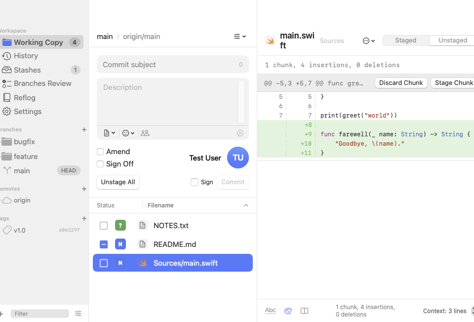

# Gitter

A free, native macOS Git client modelled on [Tower](https://www.git-tower.com). SwiftUI front end, the system `git` as the engine, no accounts, no telemetry.



## Install

Download `Gitter-<version>.zip` from the [Releases](https://github.com/romadinov/gitter/releases) page, unzip, and drag `Gitter.app` to `/Applications`. The app is ad-hoc signed, not notarized, so on first launch right-click it and choose **Open** (or run `xattr -d com.apple.quarantine /Applications/Gitter.app`).

## Build and run

Requirements: macOS 15 or later, Xcode 16+ (Swift 6 toolchain), `git` on the system.

```sh
swift build                      # debug build
.build/debug/Gitter --repo ~/Dev/my-project

Scripts/build-app.sh             # release build + build/Gitter.app with icon
open build/Gitter.app
```

Drag `build/Gitter.app` into `/Applications` if you want it in Launchpad. Folders can be dropped onto the Dock icon or onto the window.

## Features

**Working copy**
- Changed files or full file tree, with status badges and staged / partially staged checkboxes
- Diff viewer with syntax coloring, wrapped lines, adjustable context, whitespace toggle
- Stage, unstage and discard whole files, chunks, or individually selected lines (⇧-click for ranges)
- Commit with subject/description, amend, sign-off trailer, GPG/SSH signing, commit templates, gitmoji, co-author trailer
- Ignore, stop tracking, rename, trash, reveal, open in editor or external diff tool
- Create and apply patches (`.patch` / `.diff`, including `format-patch` mailboxes)
- Conflict resolution: use mine / theirs, open merge tool, mark resolved; continue or abort merges, rebases, cherry-picks and reverts

**History**
- History for all branches or any branch, tag or stash, with commit graph, search (message, author, hash), topological or date order, first-parent view, compact rows
- Unsynced markers for commits not yet pushed / pulled
- Commit details with changed files, signature status, parents; full or per-file diff
- File history, blame, browse any revision's tree, export file or ZIP archive, save commit as patch
- Cherry-pick, revert, reset (soft / mixed / hard), checkout detached, branch or tag from any commit
- Reflog view to recover lost commits and branches

**Branches, tags, remotes**
- Create, check out, rename, delete, publish, track, compare branches; merge (fast-forward, no-ff, squash) and rebase
- Interactive rebase with drag-to-reorder, squash, fixup and drop
- Branches Review: merged / stale status against a base branch with bulk cleanup
- Tags (lightweight and annotated) with push and delete; remotes add / edit / remove / prune
- Fetch, pull (merge or rebase), push, force push with lease, sync (pull then push), automatic background fetch

**Stashes and submodules**
- Stash all or only selected files (drag files onto Stashes), include untracked, keep index
- Inspect stashed diffs, apply, pop, drop, apply a single file from a stash, branch from a stash
- Submodules list, init / update, open in the app

**Undo**
- ⌘Z / ⇧⌘Z undo and redo for staging, discards, commits, amends, branch create / delete / rename / checkout, merges, rebases, pulls, cherry-picks, reverts, resets, tags, remotes and stash operations

**Navigation and drag & drop**
- Quick Actions palette (⌘K) to switch branches, run commands and jump to commits
- Drag a branch onto another to merge (⌥ to rebase); onto a remote to push; a commit onto HEAD to cherry-pick (⌥ to revert); a stash onto Working Copy to apply (⌥ to pop); a branch or commit onto the Branches header to create a branch; a file from a past commit onto Working Copy to apply it
- Repository switcher with groups (⌘0), multiple windows, recent repositories, clone in the background

**Settings**
- User profiles to switch committer identity per repository, commit templates, environment variables (e.g. 1Password SSH agent), external diff tool, diff font size

## Not included

Hosted-service integrations (GitHub / GitLab / Bitbucket pull requests, one-click OAuth cloning), AI commit messages, git-svn and Tower's Pro-tier features are out of scope: they need third-party accounts or paid APIs. Everything else works against any repository the system `git` can access, including SSH keys, credential helpers and Git LFS.

## Keyboard shortcuts

| Action | Shortcut |
| --- | --- |
| Open / Clone / New repository | ⌘O / ⇧⌘O / ⇧⌘N |
| Quick Actions | ⌘K |
| Fetch / Pull / Push / Sync | ⇧⌘F / ⇧⌘L / ⇧⌘P / ⇧⌘Y |
| Commit | ⌘↩ (in the commit box) |
| New branch / Stash | ⌘B / ⇧⌘S |
| Working Copy / History / Stashes / Branches Review / Reflog | ⌘1 … ⌘5 |
| Undo / Redo | ⌘Z / ⇧⌘Z |
| Refresh | ⌘R |
| Repositories | ⌘0 |
